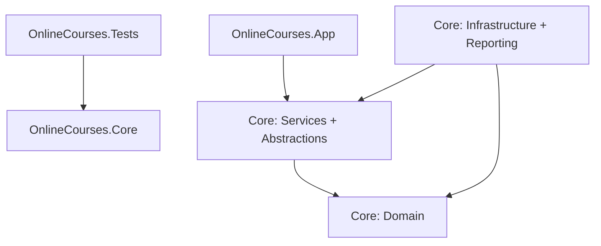

# Архітектура OnlineCourses

## 1. Архітектурний підхід

OnlineCourses — консольна система обліку зарахувань на онлайн-курси.
Рішення має три проєкти: Core, App і Tests. Усередині Core
розділено домен, прикладні сервіси, контракти й файлові адаптери.

## 2. Шари та їхні межі

| Шар | Відповідальність | Заборонені залежності |
|---|---|---|
| Домен | Сутності, стани та інваріанти | Файли, JSON, консоль, інші шари |
| Прикладний | Сценарії, контракти сховища, годинника й журналу, політики | Формат зберігання та консоль |
| Інфраструктура | JSON-сховище, системний годинник, файловий журнал | Правила предметної області |
| Застосунок | Меню, введення/виведення, composition root | Доменні розрахунки та правила |

## 3. Напрям залежностей



**Рисунок 1 — Напрям залежностей між проєктами та логічними шарами.**

- App посилається на Core, щоб викликати прикладні сценарії.
- Прикладний шар використовує доменні типи та власні абстракції.
- JSON-репозиторій реалізує `IEnrollmentRepository`, оголошений у Core.
- Домен не посилається на інфраструктуру або застосунок.
- Тести посилаються на Core та App, але виробничі проєкти не залежать від Tests.

Core залишається однією збіркою, тому ізоляція внутрішніх просторів
імен не забезпечується компілятором. Її додатково перевіряє
`DomainAndRepositoryBoundaryTests`; це слабше за фізичне розділення
на окремі проєкти й свідомо прийняте обмеження навчального рішення.

## 4. Композиційний корінь

Єдине місце створення конкретних залежностей — `Program.cs`.
Консольна взаємодія винесена в `ConsoleApplication`, а системний
ввід/вивід підміняється через `IConsole`.

```csharp
var repository = new JsonEnrollmentRepository(
    Path.Combine("data", "online-courses.json"),
    Path.Combine("data", "online-courses.seed.json"));
var clock = new SystemClock();
using var auditLog = new FileAuditLog(
    Path.Combine("logs", "application.log"), clock);
var service = new EnrollmentService(repository, clock, auditLog);
var application = new ConsoleApplication(
    repository, service, new CoursePackagePricingPolicy(),
    auditLog, new SystemConsoleAdapter());
application.Run();
```

Усі конкретні реалізації зібрані в точці входу. Тому заміна сховища,
годинника, журналу або консолі не потребує створення цих залежностей
усередині прикладних сценаріїв.

## 5. Точки розширення

| Точка | Механізм | Можлива зміна |
|---|---|---|
| Сховище | `IEnrollmentRepository` | Перехід з JSON на інше сховище |
| Пакетна ціна | `ICoursePackagePricingPolicy` | Додавання нової стратегії знижки |
| Джерело часу | `IClock` | Фіксований або інший системний час |
| Журнал | `IAuditLogger` | Інший канал журналювання |
| Консоль | `IConsole` | Тестовий ввід/вивід або інший інтерфейс |

## 6. Архітектурні обмеження

- Core об'єднує домен, прикладний шар та інфраструктуру в одній збірці.
- Файлові адаптери розміщені в Core/Infrastructure і Core/Reporting.
- JSON-файл читається та записується цілком; це підходить для навчального
  набору даних, але не для великого конкурентного навантаження.
- Консольний інтерфейс підмінний через `IConsole`, а файлові залежності
  — через контракти, що дозволяє тестувати основні сценарії без реальних
  файлів і консолі.
