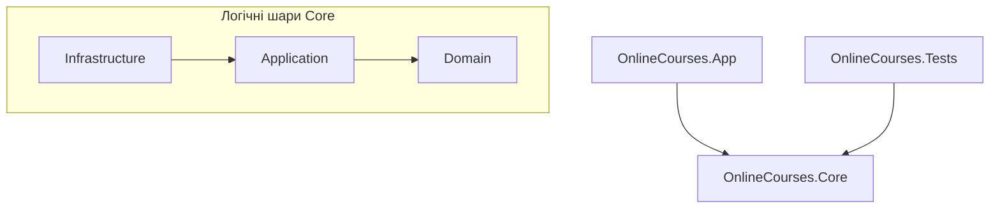

# Архітектура OnlineCourses

## 1. Архітектурний підхід

Рішення має три проєкти: Core, App і Tests. Усередині Core логічно виділено домен, прикладні сервіси, абстракції, інфраструктурні адаптери, політики ціни та звітність. App відповідає за консольний інтерфейс і composition root. Tests перевіряє логіку та використовує тестові дублери.

## 2. Шари й обмеження

| Шар | Вміст | Заборонено |
|---|---|---|
| Domain | Member, Course, CourseGroup, Enrollment, EnrollmentStatus, DomainRuleException | Знати про файли, JSON, консоль і зовнішні сервіси |
| Application | EnrollmentService, критерії пошуку, контракти репозиторію, годинника й журналу | Знати формат зберігання та читати консоль |
| Infrastructure | JsonEnrollmentRepository, InMemoryEnrollmentRepository, SystemClock, FileAuditLog | Містити бізнес-правила зарахування або пакетної ціни |
| Presentation | Program.cs, парсинг вводу, форматування звітів, composition root | Дублювати доменні перевірки та формули |
| Tests | xUnit-тести, FakeEnrollmentRepository, FixedClock, RecordingAuditLogger | Залежати від реального користувацького вводу |

Фізично Domain, Application та Infrastructure розташовані в одному проєкті Core. Це свідомий компроміс: не перебудовувати наявну навчальну структуру. Тому внутрішнє правило залежностей перевіряється архітектурним тестом.

## 3. Схема залежностей



**Рисунок 1 — Схема залежностей проєктів і логічних шарів.**

- App → Core: консольний застосунок викликає прикладні сценарії й використовує інфраструктурні реалізації для складання залежностей.
- Tests → Core: модульні тести перевіряють доменні правила та прикладні сервіси.
- Application → Domain: сервіс працює з сутностями та станами.
- Infrastructure → Application: файловий репозиторій реалізує контракт, оголошений у Core/Abstractions.
- Domain не посилається на Infrastructure, App або Tests.

## 4. Контракти та реалізації

| Контракт | Відповідальність | Реалізація / дублер |
|---|---|---|
| IEnrollmentRepository | Отримання та збереження навчальних сутностей | InMemoryEnrollmentRepository, JsonEnrollmentRepository, FakeEnrollmentRepository |
| ICoursePackagePricingPolicy | Розрахунок пакетної ціни | CoursePackagePricingPolicy |
| IClock | Поточний час і дата | SystemClock, FixedClock |
| IAuditLogger | Записи Information, Warning, Error | FileAuditLog, RecordingAuditLogger |

## 5. Композиційний корінь

Композиційний корінь розміщений у Program.cs. Конкретні реалізації створюються тут і передаються сервісу через конструктор:

```csharp
var repository = new JsonEnrollmentRepository(
    Path.Combine("data", "online-courses.json"),
    Path.Combine("data", "online-courses.seed.json"));
var clock = new SystemClock();
using var auditLog = new FileAuditLog(
    Path.Combine("logs", "application.log"), clock);
var enrollmentService = new EnrollmentService(
    repository, clock, auditLog);
```

Завдяки цьому EnrollmentService залежить від інтерфейсів, а не від конкретного JSON-файлу чи системного часу. У тестах замість файлового репозиторію й системного годинника можна передати фейк і FixedClock.

## 6. Точки розширення

1. **Інша пакетна знижка.** Додати реалізацію ICoursePackagePricingPolicy. Сервіс зарахування не змінюється.
2. **Інший формат зберігання.** Додати адаптер IEnrollmentRepository для CSV або іншого сховища. Прикладний сервіс не залежить від формату.
3. **Новий спосіб сповіщення.** Додати реалізацію IAuditLogger або окремий notifier, не змінюючи доменні сутності.

## 7. Компроміси

Три проєкти зберігають сумісність із попередніми лабораторними роботами, але не дають компілятору фізично заборонити зворотні залежності всередині Core. JSON-файл простий для перевірки та резервного копіювання, але повністю перезаписується після зміни й не підходить для одночасного редагування багатьма користувачами. In-memory реалізація лишається корисною для ізольованих тестів.
