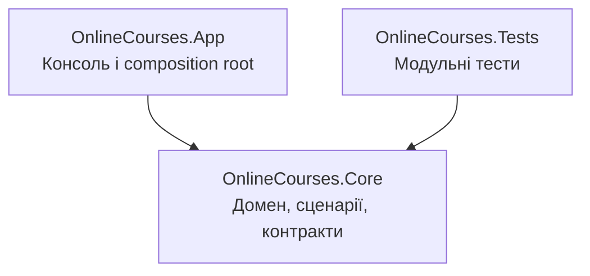

# Архітектура OnlineCourses

## 1. Архітектурний підхід

Рішення побудоване як консольний застосунок із бібліотекою логіки та окремим проєктом модульних тестів. Поточна структура відповідає дозволеному методичкою варіанту з трьома проєктами: `OnlineCourses.Core` містить доменну й прикладну логіку, `OnlineCourses.App` відповідає за взаємодію з користувачем, `OnlineCourses.Tests` перевіряє поведінку бібліотеки.

У межах `OnlineCourses.Core` код розділений за просторами імен та каталогами. Це логічне, а не фізичне розділення збірок: компілятор не забороняє класам усередині Core посилатися один на одного. Тому напрям залежностей додатково контролюється домовленістю, перевіркою коду та тестами.

## 2. Проєкти та відповідальність шарів

| Проєкт / шар | Відповідальність | Чого не повинен робити |
|---|---|---|
| `OnlineCourses.Core/Domain` | Сутності слухача, курсу, групи й зарахування; стани та інваріанти | Не читати файли, не працювати з консоллю й не форматувати звіти |
| `OnlineCourses.Core/Services` | Координація сценаріїв зарахування, відрахування, переведення, пошуку й звіту | Не створювати файлові сховища та не читати консоль |
| `OnlineCourses.Core/Abstractions` | Контракти репозиторіїв, політик розрахунку та інших залежностей | Не містити конкретної файлової реалізації |
| `OnlineCourses.Core/Pricing` | Чисті розрахунки пакетної знижки | Не змінювати стан слухачів, курсів або зарахувань |
| `OnlineCourses.Core/Reporting` | Формування моделі звіту про наповнюваність груп | Не виконувати введення з консолі |
| `OnlineCourses.App` | Меню, парсинг введення, форматування результатів і композиційний корінь | Не дублювати доменні правила та формули |
| `OnlineCourses.Tests` | Модульні тести домену й прикладних сценаріїв, тестові дублери | Не залежати від реальних файлів або ручного введення |

Поточна реалізація має `Domain`, `Services`, `Abstractions`, `Pricing` і `Reporting` у бібліотеці Core. Перед завершенням роботи конкретні файлові реалізації сховищ потрібно відокремити в каталог інфраструктури або чітко позначити їхнє місце в поточній структурі. У звіті не слід називати інфраструктуру окремим проєктом, поки такого проєкту немає.

## 3. Схема залежностей



**Рисунок 1 — Схема залежностей проєктів OnlineCourses.**

- `OnlineCourses.App → OnlineCourses.Core`: консольний застосунок викликає прикладні сервіси й використовує доменні типи.
- `OnlineCourses.Tests → OnlineCourses.Core`: тести перевіряють поведінку бібліотеки логіки.
- `OnlineCourses.Core` не має посилання на `OnlineCourses.App` або `OnlineCourses.Tests`.

Усередині Core бажаний напрям залежностей такий: прикладні сервіси використовують доменні сутності й оголошені абстракції; доменні сутності не знають про сервіси, консоль або зберігання. Конкретні реалізації сховищ мають реалізовувати інтерфейси, оголошені в Core, і не переносити правила предметної області в інфраструктурний код.

## 4. Композиційний корінь

Композиційний корінь розміщується в точці входу `OnlineCourses.App/Program.cs`. Саме тут створюються конкретні реалізації репозиторію, політики розрахунку, журналу та сервісів і передаються через конструктори.

Фрагмент нижче показує принцип складання залежностей; назви типів потрібно узгодити з фактичними реалізаціями після завершення доменної моделі:

```csharp
var repository = new InMemoryEnrollmentRepository();
IPricingPolicy pricing = new CoursePackagePricingPolicy();
var logger = loggerFactory.CreateLogger<EnrollmentService>();
var service = new EnrollmentService(
    repository,
    pricing,
    logger);
```

Об'єкти створюються в одному місці, щоб прикладна логіка не залежала від способу створення сховища або політики. Під час тестування ті самі конструктори отримують фейковий репозиторій і тестову політику.

## 5. Основні контракти

| Контракт | Призначення | Реалізація / тестовий дублер |
|---|---|---|
| `IEnrollmentRepository` | Додати, знайти, оновити та отримати зарахування | Файлове або in-memory сховище; Fake у тестах |
| `IPricingPolicy` | Розрахувати пакетну знижку та суму до сплати | `CoursePackagePricingPolicy` |
| `IClock` | Надати поточну дату для операцій, де вона потрібна | Системний годинник і FixedClock у тестах |

У поточному коді вже є `IRegistrationRepository` та `IPricingPolicy`. Під час переходу до термінології варіанта їх потрібно послідовно перейменувати або адаптувати, щоб назви відповідали предметній області. `IClock` додається лише якщо дата операції справді використовується логікою; для тестування часу не слід вводити інтерфейс без реальної потреби.

## 6. Точки розширення

1. **Новий тип пакетної знижки.** Додається нова реалізація `IPricingPolicy` або окрема стратегія; сценарії зарахування не повинні змінюватися.
2. **Інший спосіб зберігання.** Додається реалізація `IEnrollmentRepository` для JSON чи CSV; прикладні сервіси працюють із контрактом і не залежать від формату.
3. **Нові критерії пошуку.** До параметрів пошуку додається критерій, а фільтрація залишається окремою операцією прикладного шару; доменні сутності не повинні знати про консольний формат запиту.

## 7. Архітектурні обмеження

- Залежності передаються через конструктори.
- Доменні правила місткості, передумов і станів розміщуються в домені або прикладному сервісі, але не в консольному меню чи файловому адаптері.
- Грошові значення мають тип `decimal`.
- Дати операцій задаються через `DateOnly` або `DateTimeOffset`.
- Розрахунок пакетної знижки та наповнюваності є детермінованим: однакові вхідні дані дають однаковий результат.
- Перевірки користувацького вводу виконуються на межі прикладного шару до зміни стану.
- Звіт формується з активних зарахувань; відраховані та завершені зарахування не займають місця групи.
