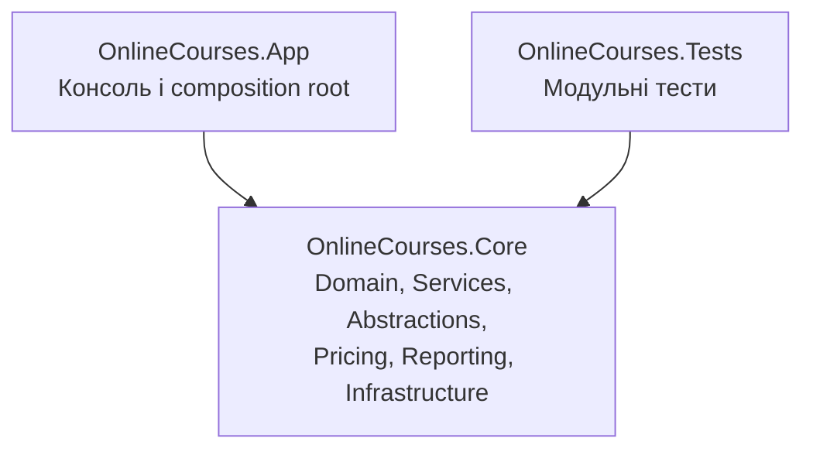

# Архітектура OnlineCourses

## 1. Архітектурний підхід

OnlineCourses — консольний застосунок для обліку зарахувань на онлайн-курси. Рішення складається з трьох .NET-проєктів: бібліотеки логіки `OnlineCourses.Core`, консольного застосунку `OnlineCourses.App` і тестового проєкту `OnlineCourses.Tests`.

У Core логічно розділено домен, прикладні сервіси, абстракції, політику ціноутворення, звітність і файлову інфраструктуру. Це каталоги та простори імен однієї збірки, а не окремі проєкти. Через це компілятор не забезпечує повної ізоляції внутрішніх шарів; поточні обмеження залежностей потрібно перевіряти окремо.

## 2. Проєкти та відповідальність

| Проєкт / каталог | Відповідальність |
|---|---|
| `OnlineCourses.Core/Domain` | `Member`, `Course`, `CourseGroup`, `Enrollment`, стани й доменні інваріанти |
| `OnlineCourses.Core/Services` | Сценарії зарахування, відрахування, переведення, завершення, пошуку та звіту |
| `OnlineCourses.Core/Abstractions` | Контракти репозиторію, годинника, журналювання та політики пакетної ціни |
| `OnlineCourses.Core/Pricing` | Чистий розрахунок пакетної знижки |
| `OnlineCourses.Core/Reporting` | Модель рядка звіту наповнюваності |
| `OnlineCourses.Core/Infrastructure` | JSON-адаптер `JsonEnrollmentRepository` |
| `OnlineCourses.Core/Reporting` | Файловий журнал `FileAuditLog` |
| `OnlineCourses.App` | Консольне меню, введення/виведення та композиційний корінь у `Program.cs` |
| `OnlineCourses.Tests` | Модульні тести, фейкові залежності та перевірка бізнес-правил |

Файлова інфраструктура наразі розташована в тій самій збірці Core, що й домен та прикладні сервіси. Це свідоме спрощення структури трьох проєктів; воно не є повною реалізацією окремого зовнішнього Infrastructure-проєкту.

## 3. Напрям залежностей

**Рисунок 1 — Залежності між проєктами OnlineCourses.**

- `OnlineCourses.App → OnlineCourses.Core`: застосунок створює конкретні адаптери та викликає прикладні сервіси.
- `OnlineCourses.Tests → OnlineCourses.Core`: тести перевіряють доменну й прикладну поведінку.
- Core не посилається на App або Tests.

Усередині Core прикладний сервіс `EnrollmentService` працює через `IEnrollmentRepository`, `IClock` і `IAuditLogger`. Конкретний JSON-адаптер реалізує контракт репозиторію. Доменні сутності не читають файли й не взаємодіють із консоллю.

## 4. Композиційний корінь

Композиційний корінь розташований у `OnlineCourses.App/Program.cs`. У ньому створюються:
- `JsonEnrollmentRepository` із робочим файлом `data/online-courses.json` та початковим набором `data/online-courses.seed.json`;
- `SystemClock` для отримання поточної дати;
- `FileAuditLog` для запису подій у `logs/application.log`;
- `EnrollmentService` із репозиторієм, годинником і журналом;
- `CoursePackagePricingPolicy` для розрахунку пакетної вартості.

Точка входу наразі також містить цикл консольного меню. Тому композиційний корінь ще не винесений в окремий короткий метод/клас, а консольний ввід не підміняється через інтерфейс. Це відома архітектурна межа поточної версії, яку потрібно врахувати під час подальшого доопрацювання.

## 5. Контракти та точки розширення

| Контракт | Призначення | Поточна реалізація / тестовий дублер |
|---|---|---|
| `IEnrollmentRepository` | Доступ до слухачів, курсів, груп і зарахувань | `JsonEnrollmentRepository`, `InMemoryEnrollmentRepository` |
| `ICoursePackagePricingPolicy` | Розрахунок ціни пакета курсів | `CoursePackagePricingPolicy` |
| `IClock` | Поточний час і календарна дата | `SystemClock`, `FixedClock` у тестах |
| `IAuditLogger` | Запис інформаційних, попереджувальних і помилкових подій | `FileAuditLog`, `RecordingAuditLogger` у тестах |

Реальні точки розширення:
1. **Заміна сховища.** Інша реалізація `IEnrollmentRepository` може зберігати ті самі сутності в іншому форматі без зміни `EnrollmentService`.
2. **Заміна політики ціноутворення.** Інша реалізація `ICoursePackagePricingPolicy` може застосувати інші ставки або правила, не змінюючи консольний сценарій.
3. **Заміна джерела часу.** Інша реалізація `IClock` дає змогу використовувати контрольований час у тестах або інше джерело дати.
4. **Заміна журналу.** Інша реалізація `IAuditLogger` може спрямовувати події в інший журнал або систему моніторингу.

## 6. Архітектурні обмеження та відомі борги

- Доменні правила місткості, передумов і переходів станів реалізовані в домені та `EnrollmentService`, а не у файловому адаптері.
- Грошові значення представлені типом `decimal`.
- Дата зарахування представлена типом `DateOnly`; системний час ізольований через `IClock`.
- Розрахунок пакетної знижки не змінює стан курсів або зарахувань.
- JSON-адаптер і файловий журнал розташовані в Core, а не в окремому Infrastructure-проєкті.
- Консольне меню та композиційний корінь наразі поєднані в `Program.cs`; абстракція консолі відсутня.
- Окремий автоматизований архітектурний тест, який забороняє неправильні міжшарові залежності, ще потрібно додати.
